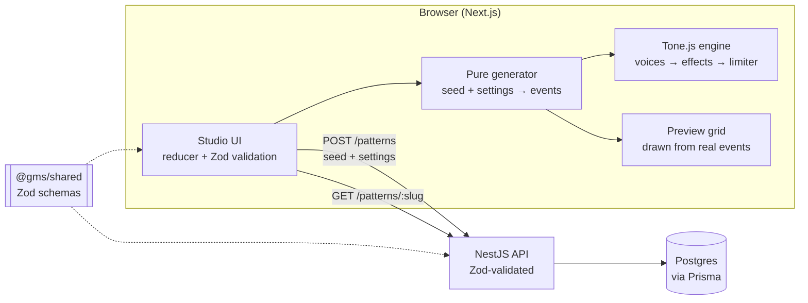

<div align="center">

# Generative Music Studio

**Pick a seed. Hear a track. Send someone the link and they hear the exact same one.**

A browser-based generative music tool where every sound is a pure function of a number and a handful of settings.


[Live demo](#) · [How it works](#how-it-works) · [Run it locally](#run-it-locally) · [Deploy it](#deploying)

</div>

<!-- Add a screenshot or a short GIF of the Studio here. A 10 second clip of the playhead moving does more than any paragraph. -->

---

## What this is

I wanted to build something that sounds good, feels calm, and is still a real full-stack project with a real engineering problem at the center of it.

Generative Music Studio makes short, loopable pieces of music in the browser. You choose one of six generators (arpeggio, melody, bassline, drum pattern, ambient pad, texture), roll a seed, tweak the settings and effects, and press play. When you like what you hear, you save it and get a share link. Anyone who opens that link hears the same track, note for note.

That last part is the whole point, and it's what drove most of the design.

## The one rule: determinism

```
events = generate(seed, settings)
```

Everything flows from that line.

- The **same seed and settings always produce the same notes**. No `Math.random` at generation time or at playback time.
- **Effects, tempo, swing and timbre never change the notes.** They are post-processing. Dragging the reverb slider can't reshuffle your melody.
- Every generator draws from **separate sub-seeds per concern** (rhythm, pitch, density, velocity and so on), so nudging one setting doesn't scramble everything else.
- Density uses **importance-ranked thinning** with fixed, seed-only ranks. A track at density 0.9 is a strict superset of the same track at 0.3, so turning the knob feels like adding or removing notes, not rolling new dice.

Because generation is deterministic, the backend only has to store `seed + settings`. A saved track is a few hundred bytes, and loading one is just running the generator again.

### How I keep myself honest

Every generator logs an **event-list hash** in dev. The test suite pins hashes for fixed seed and settings pairs across all six generators, so if a refactor changes a single note anywhere, a test fails. Adding a new generator or touching the audio engine must never move an existing hash. That one check caught more bugs than anything else in the project.

## The six generators

Each generator picks an **archetype** from the seed, then draws its parameters, then picks a voice. Archetypes differ in rhythm *and* in contour or texture, not just surface settings, so different seeds sound like different pieces rather than the same piece with new numbers.

| Generator | Archetypes | Notes |
| --- | --- | --- |
| **Arpeggio** | rolling, polymeter, euclid, broken-chord, leap, echo | Euclidean onset skeletons; voices: pluck, bell, soft, buzz |
| **Melody** | stepwise-arch, motif-and-variation, call-and-response, leap-and-fill, pedal-ostinato, sparse-lyrical | Monophonic, in-scale, phrases resolve toward a stable degree |
| **Bassline** | root-pulse, octave-bounce, walking, syncopated-funk, pedal-with-fills, sub-swell | Anchored to the key root; voices carry upper harmonics so they survive laptop speakers |
| **Drum pattern** | four-on-floor, boom-bap, breakbeat, half-time, euclid-polyrhythm, sparse-minimal | Six lanes, ghost notes, hat choking, kits: acoustic / electronic / lo-fi |
| **Ambient pad** | drifting-triads, suspended-clouds, open-fifths, slow-arp-swells, modal-shift, drone-plus-colour-tones | Slow chords; the generator itself caps overlap at 6 sounding notes |
| **Texture** | dust-grains, rain-pulse, shimmer-swells, breath-noise, metallic-drips, granular-cloud | Sparse gestures with capped density and overlap |

Seed diversity is tested too: across 50 seeds every archetype must appear, and a pairwise similarity metric has to stay under a threshold per generator.

## How it works



**Shared schemas.** The Zod schemas live in a workspace package, `@gms/shared`, and both the web app and the API import them. The UI validates a request before sending it, the API validates it on arrival, and the client validates every response. Nobody trusts a payload's shape.

**The audio engine.** One shared `Tone.Context` (`latencyHint: "playback"`), four-ish persistent instruments per generator feeding gain nodes, a serial effects chain, a `Tone.Limiter(-1)` as the last node, and a master meter. Voice changes crossfade gains. Synths are never created or disposed while music is playing. Sequence rebuilds are debounced (120 ms) and keyed on an event signature, so changing a pure playback setting never rebuilds the sequence.

**The effects chain.** Eight effects exist (distortion, phaser, chorus, vibrato, filter, tremolo, delay, reverb). An effect at amount 0 is fully disconnected from the graph, and effects ramp in and out over 80 ms so toggling never clicks. At default settings only delay and reverb are connected.

**The preview.** The pattern preview is drawn from the real generated events, not a decoration. The playhead is tied to those same events.

## The crackle story (a short engineering diary)

The hardest bug in this project wasn't in the music logic. During arpeggio playback the audio would crackle, and only with effects on.

What it wasn't: clipping (the limiter never reported peaks), the suspended AudioContext warning on load (harmless, `Tone.start()` runs on the Play click), and drift warnings (Chrome throttles hidden tabs). What narrowed it down was adding dev-only bisect flags (`?fx=off`, `?fx=reverb`, `?fx=reverb,delay`) and testing one effect at a time. Reverb alone crackled; delay alone was clean.

The cause was `Tone.Reverb`, which is a convolver and therefore expensive on the audio thread. Swapping it for `Tone.Freeverb` (fixed room size and dampening, amount mapped to wet level only) fixed it. I pinned that in a test so nobody quietly "upgrades" it back.

The lessons that stuck: bisect audio problems instead of guessing, make dev diagnostics cheap to reach, and keep CPU headroom as a design constraint for every new generator rather than a bug to fix later.

## Features

- Six seeded generators with six archetypes each, and persistent, crossfading voices
- Seed shuffle and copy, paged 16-column preview, live request-preview JSON
- Tempo, swing and a configurable effects chain, all playback-only
- **Save and share:** `POST /patterns` gives you a slug, and `/track/[slug]` loads and plays it
- **Remix:** open `/?remix={slug}` to start from someone else's track; a "Remixed from" pill keeps the lineage
- Honest error states: validation, not found, rate limited (honours `Retry-After`), network, server and timeout, plus a "Waking the server…" message for free-tier cold starts
- Accessibility: full ARIA tabs pattern, labelled sliders with human-readable `aria-valuetext`, visible focus rings, a skip link, live-region announcements, `prefers-reduced-motion` support (the playhead still moves, because it carries information), 44px touch targets on coarse pointers
- Open Graph and Twitter metadata per track, so shared links look right

### Deliberately left out

No accounts, no public/private toggle, no versioned engine or schema fields. This is a portfolio project that won't be updated after it ships, so I chose a smaller surface over speculative flexibility. Saved tracks are reachable by link, which is the point.

## Tech stack

| Layer | Choice |
| --- | --- |
| Frontend | Next.js (App Router), React, TypeScript |
| Audio | Tone.js on the Web Audio API |
| Backend | NestJS, Prisma, PostgreSQL |
| Validation | Zod, shared through the `@gms/shared` workspace package |
| Tooling | pnpm workspaces, Vitest, React Testing Library, ESLint, oxlint |
| Hosting (suggested) | Vercel (web), Render (API), Neon (Postgres) |

## Project structure

```
.
├── app/
│   ├── web/        # Next.js frontend: Studio UI, generators, audio engine
│   │   ├── audio/  #   engine, effects chain, voices, generators, hashing
│   │   ├── lib/    #   API client, request builder, preview mapping
│   │   └── components/
│   ├── api/        # NestJS API: patterns, health check, rate limiting
│   └── shared/     # @gms/shared: Zod schemas used by web and api
├── render.yaml     # Render blueprint for the API
└── README.md
```

## Run it locally

**You'll need:** Node 20+, pnpm, and a PostgreSQL database (local or a free Neon project).

```bash
# 1. Clone and install
git clone https://github.com/cage4D/<repo-name>.git
cd <repo-name>/app
pnpm install

# 2. Configure the API
cp api/.env.example api/.env
#    set DATABASE_URL in api/.env

# 3. Build the shared package, generate the Prisma client, run migrations
pnpm build:shared
pnpm prisma:generate
pnpm prisma:deploy

# 4. Configure the web app
cp web/.env.example web/.env.local
#    set NEXT_PUBLIC_API_URL=http://localhost:4000

# 5. Run both (two terminals)
pnpm --filter api start:dev     # API on :4000
pnpm --filter web dev           # Studio on :3000
```

Open <http://localhost:3000>, press Play, and click **Shuffle** a few times.

> **Heads up:** audio can only start after a user gesture, so the first Play click is what wakes the audio context. Console warnings about a suspended `AudioContext` on page load are expected.

### Environment variables

| Variable | Where | Purpose |
| --- | --- | --- |
| `DATABASE_URL` | api | Postgres connection string (use the direct, non-pooled one for migrations) |
| `PORT` | api | Port to listen on (default `4000`) |
| `CORS_ORIGINS` | api | Comma-separated allowed web origins. Wildcards are rejected in production |
| `NEXT_PUBLIC_API_URL` | web | Base URL of the API, no trailing slash |
| `NEXT_PUBLIC_SITE_URL` | web | Public URL of the web app, used for metadata and share links |

The API also has a built-in per-IP rate limiter. Its limits are configurable through environment variables; see `app/api/.env.example`.

### API at a glance

| Method | Route | Description |
| --- | --- | --- |
| `GET` | `/health` | Liveness check, no database access |
| `POST` | `/patterns` | Save `seed + settings`, returns the pattern with its slug |
| `GET` | `/patterns/:slug` | Load one pattern |
| `GET` | `/patterns` | List patterns (a gallery page is a future idea) |

## Developer tools (dev only)

Query flags that only work under the dev server, built for bisecting audio problems:

| Flag | Effect |
| --- | --- |
| `?fx=off` | Remove all effects from the chain |
| `?fx=reverb` / `?fx=delay` | Remove just those effects (comma-separate for several) |
| `?voice=<kind>` | Force a specific voice for the current generator |
| `?draw=off` | Turn off preview drawing |

A page loaded with an `?fx=` flag has inert sliders for the removed effects. That's intentional. In dev the console also logs the event-list hash and the active chain, for example `chain=[delay, reverb]`.

If you ever see a stale UI or "impossible" behaviour while developing, hard-refresh and make sure only one server is running. Old production builds cached in the browser caused several fake bugs during development.

## Testing

```bash
pnpm lint
pnpm test                      # web + api unit tests
pnpm --filter api test:e2e     # API end-to-end tests (needs Postgres)
pnpm build                     # shared → prisma → api → web
```

What the tests actually protect:

- **Hash pins.** Fixed seed and settings pairs for every generator must keep producing the same event-list hash.
- **Determinism and invariance.** Same input gives the same events; effects, tempo, swing and timbre changes never change them.
- **Archetype diversity.** Across 50 seeds each archetype appears, and a similarity ceiling holds.
- **Caps and invariants.** Density supersets, note-overlap limits for pads and textures, drum hat choking.
- **Save then load.** A saved pattern reloaded through a mocked API reproduces the same hash.
- **API client.** Every error type maps correctly; malformed responses are rejected.
- **Accessibility behaviour.** Tab arrow-key navigation, slider labels and `aria-valuetext`, live-region announcements, reduced motion, the error boundary.

Audio is the one thing the automated tests can't judge. The review process for every generator was the same: listen to ten or more seeds, check they sound different from each other, listen for crackle, then commit.

## Deploying

The suggested free-tier setup is **Neon** (Postgres), **Render** (API) and **Vercel** (web). Order matters:

1. **Neon.** Create a project and copy the **direct** connection string. From `app/`, run `pnpm prisma:deploy` once with that `DATABASE_URL` to apply migrations. The Render build does not run them.
2. **Render.** New → Blueprint → select this repo (it reads `render.yaml`). Set `DATABASE_URL` and a placeholder `CORS_ORIGINS`. Deploy and check `https://<api-host>/health`.
3. **Vercel.** New Project with Root Directory `app/web`, and turn on **Include source files outside the Root Directory** (the shared package lives outside it). Set `NEXT_PUBLIC_API_URL` and `NEXT_PUBLIC_SITE_URL` for Build and Production, then deploy.
4. **Close the loop.** Put the Vercel URL in `CORS_ORIGINS` on Render and redeploy the API. Until then, saving from the live site fails with CORS errors.

Render's free tier sleeps when idle, so the first save after a quiet spell can take a while. The UI shows "Waking the server…" and waits it out.

## Design influences

I wanted something ethereal, sleek and understated, with balanced motion and Manrope for the logo and large headings. Visual references were [The Creative Independent](https://thecreativeindependent.com) for minimalism with a distinct voice, [Udio](https://www.udio.com) for its visual treatment, and [Stable Audio](https://www.stableaudio.com) for its background idea, which I replaced with an animated sound wave. None of their palettes are used.

## Roadmap

Things I'd add if I keep going:

- A `/gallery` page (the API route already exists)
- Real HTTP 404 status on missing track pages by fetching on the server
- Audio export to WAV
- More archetypes per generator, and a "morph between two seeds" mode
- Optional account system, if there's ever a reason for one

## A note on how this was built

I designed the architecture, wrote the rules the generators have to obey, and did all of the listening. Much of the implementation was done in milestones by AI coding assistants (opencode, with prompts drafted alongside Claude) under strict guardrails: don't change generation logic, don't move a pinned hash, run the type checker, the linter and the tests, and never commit. I committed each milestone only after hearing it myself. The assistants can't hear anything, which turned out to be the clearest argument for keeping a human in the loop on a project about sound.

## License

MIT, see [LICENSE](LICENSE). <!-- add a LICENSE file, or change this line -->

## Author

**cage4D** · [github.com/cage4D](https://github.com/cage4D)

If you try it, send me a seed you love.